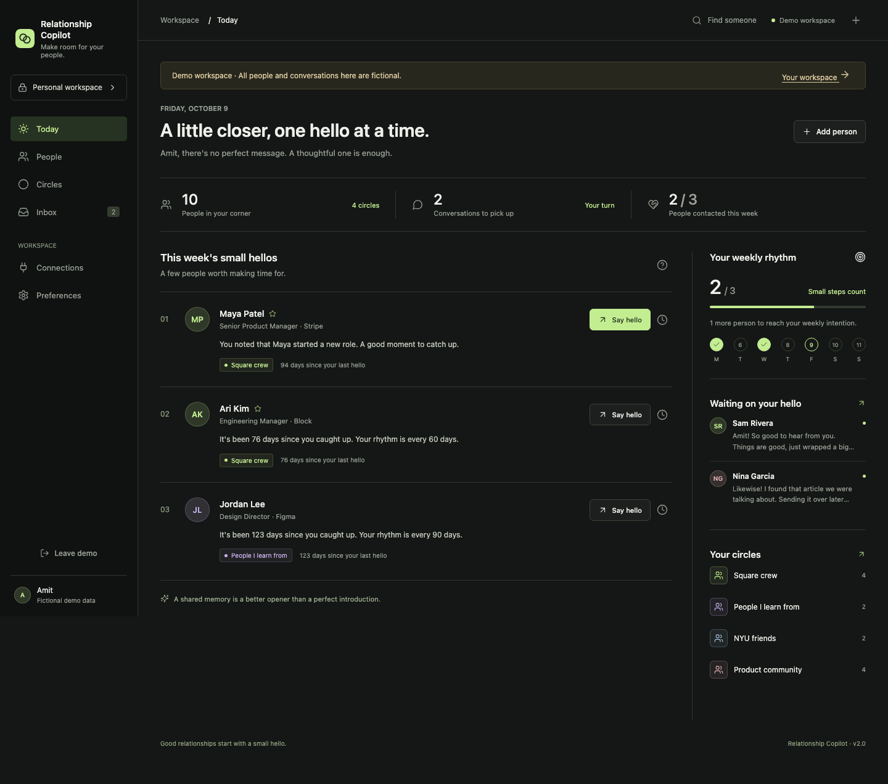
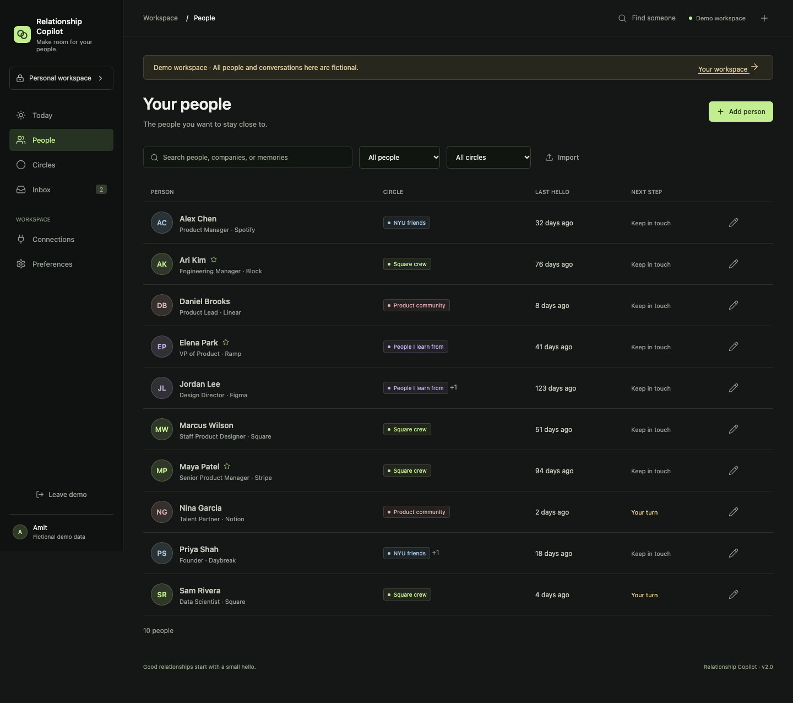
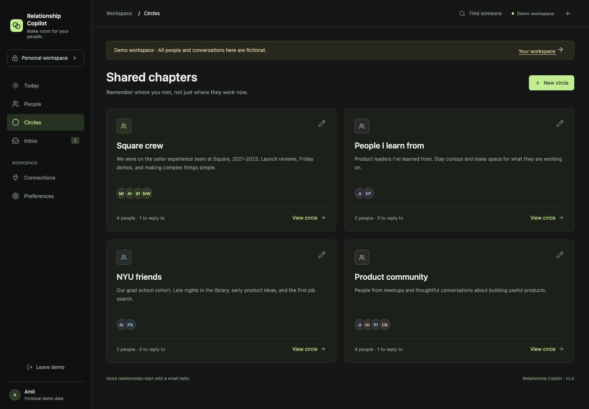
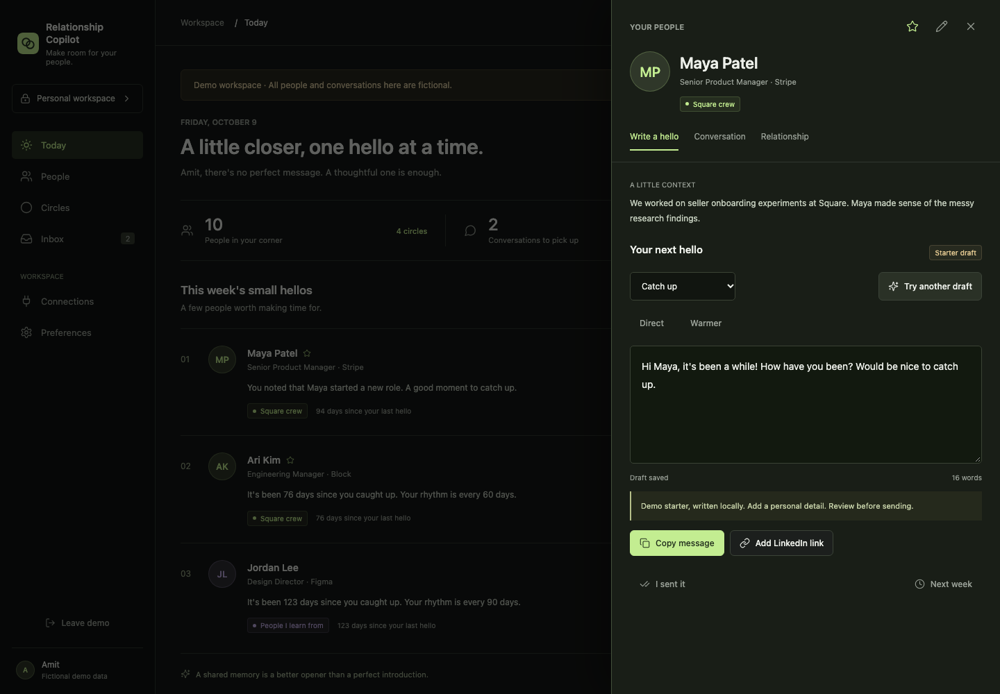
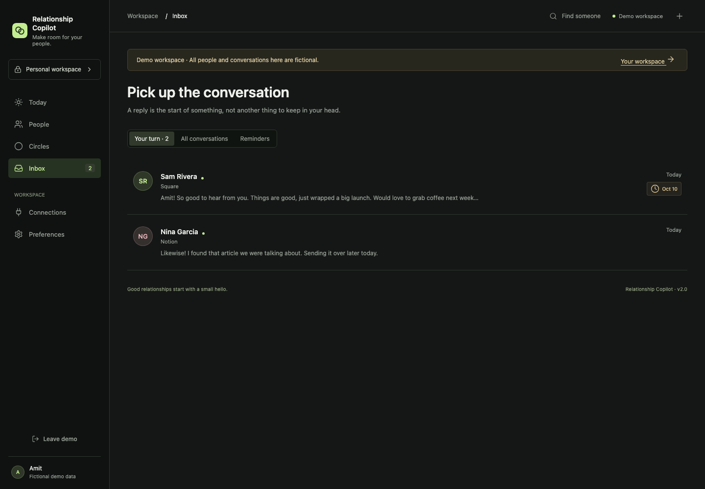
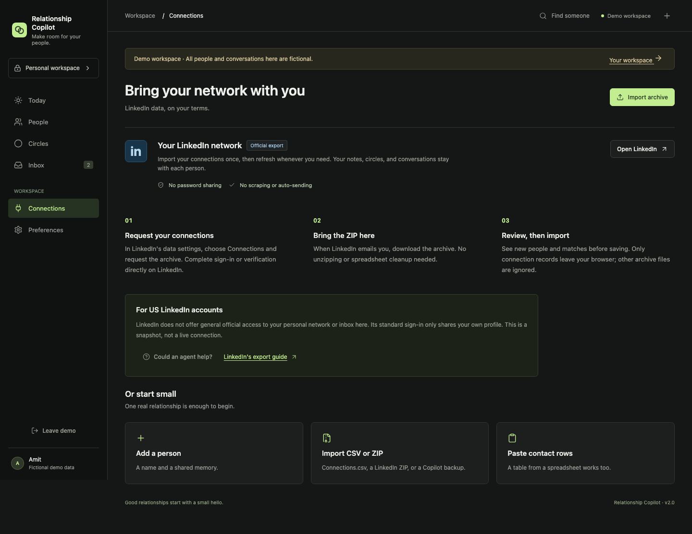

# Relationship Copilot

[](https://github.com/amit-dommeti/relationship-copilot/actions/workflows/test.yml)

**Keep in touch. Without overthinking it.**

A personal relationship workspace for the people you already know: old teammates, mentors, classmates, and the friends you keep meaning to message. Built around small, thoughtful check-ins, not sales sequences.



## The Product Loop

1. **Bring your people along.** Import LinkedIn's official ZIP directly, paste spreadsheet rows, or add one person.
2. **Remember your shared chapters.** Put former Square coworkers in a circle, even after they change jobs. Shared memories stay attached to the circle.
3. **Choose a small hello.** An explainable shortlist uses your check-in rhythm, recent conversations, and relationship context.
4. **Make it sound like you.** Optional AI produces two greeting-first drafts from selected context. Edit, copy, and send yourself.
5. **Keep the conversation going.** Save replies, clear your reply queue, snooze a check-in, or download a calendar reminder.

## A Look Around

| People, without the spreadsheet feel | Shared chapters |
| --- | --- |
|  |  |

| A focused composer | The reply queue |
| --- | --- |
|  |  |



These are real browser captures of the v2 app with fictional demo data. The composer screenshot shows the explicitly labeled no-key starter, not a claimed AI output. [All screenshots and capture procedure](docs/SCREENSHOTS.md).

**Draft recovery:** copying and browsing remain available when a save fails. Retry from the composer without retyping, and receive a browser warning before leaving with unsaved changes. Unsaved drafts stay in the current tab, not a durable offline store. [Recovery screenshot](assets/screenshots/v2/08-draft-recovery.png).

## Try It Locally

Requires Node.js 22.13+ (Node 24 LTS recommended).

```sh
npm ci
npm run dev
```

Open [localhost:4173](http://localhost:4173), or [the isolated demo](http://localhost:4173/?demo=1). Set `PORT` to choose a different port. Real data persists in `data/copilot.sqlite`; demo changes stay in a separate browser store. Clearing browser storage does not erase the real workspace.

```sh
npm test
npm run build
npx playwright install chromium
npm run test:browser
```

## LinkedIn: What Works, What Doesn't

**For a US account, this release uses LinkedIn's official data export, not live account sync.**

Import the ZIP without opening it. Only Connections.csv is extracted in the browser, then you review before saving. Repeated imports match profile URLs or emails and preserve notes, drafts, and circle membership. Names alone are not a safe identity match.

Standard LinkedIn sign-in supplies your own profile, not your network or personal inbox. Official personal data portability is region-restricted to EEA/Switzerland members. We do not offer a misleading Connect button, scrape LinkedIn, store session cookies, or send messages automatically.

A personal agent may help with the official export handoff, subject to login, site, and file-transfer limits. That is an optional workflow to test, not an implemented live integration. [US account guide and research](docs/LINKEDIN_ACCESS.md).

## AI, With Clear Boundaries

- Suggestions are **deterministic and explainable**, not AI predictions about who likes you.
- Optional message generation uses the OpenAI Responses API, defaulting to `gpt-5.6-terra`. The model is configurable.
- Only the selected person's notes, relevant circle memories, your voice preference, and up to eight saved messages are sent after you click the drafting action.
- No key: clearly labeled local starter text. Provider failure: an error, never fake AI success.
- Nothing is automatically sent to LinkedIn. Generated drafts need review.

Set `OPENAI_API_KEY` privately using your hosting provider's secrets, or an untracked local `.env`. See [.env.example](.env.example), [prompt design](MESSAGE_STYLE_PROMPT.md), and [AI evaluation plan](docs/AI_EVALUATION.md).

## Deployment

The same app supports a private hosted Site with managed sign-in and a persistent database, or a portable Node/Docker deployment with password protection and a persistent volume. [Deployment and backup guide](docs/DEPLOYMENT.md).

The repository is public; your relationship workspace should remain private. No real contacts, messages, credentials, or raw LinkedIn exports belong in this repo.

## Build Notes

- Vanilla JavaScript, semantic HTML, dark responsive CSS, Lucide icons.
- Shared request handler for Node and Cloudflare Workers.
- SQLite locally; D1 for hosted per-user storage.
- Papa Parse for CSV; fflate for bounded ZIP extraction; esbuild for packaging.
- Unit/integration tests plus Playwright flows at desktop, tablet, and mobile sizes.

## Product Decisions And Evidence

[Product brief](PROJECT_OS.md) · [Current state](CURRENT_STATE.md) · [Case study](docs/CASE_STUDY.md) · [Iteration log](docs/ITERATION_LOG.md) · [Architecture](docs/ARCHITECTURE.md) · [Demo script](docs/DEMO_SCRIPT.md) · [Release checks](docs/SHIP_CHECKLIST.md)

This is an implementation-tested personal product, not a validated business. No adoption, retention, outreach uplift, or AI preference study has been measured. Earlier iteration labels are retrospective feature milestones, not evidence of separate launches.
