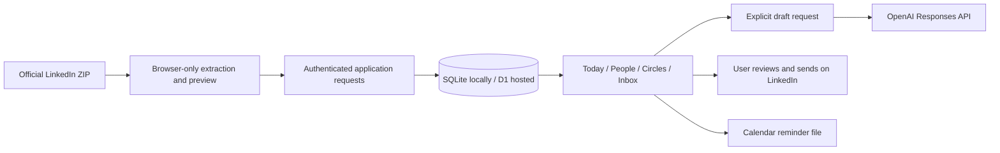

# Architecture

## Two Runtimes, One Application

- `web/`: rendering, keyboard/focus management, forms, separate demo state.
- `shared/`: data normalization, identity matching, ranking, calendar output, import parsing.
- `server/api.js`: authenticated operations, validation, owner scoping, request limits.
- `server/store.js`: relational storage with JSON records, transactional message-state updates.
- `server/node.mjs`: loopback development; protected HTTPS-origin production deployment.
- `server/worker.js`: hosted Sites identity headers, static assets, the same request handler.
- `scripts/build.mjs`: browser bundle plus a self-contained Worker and migration metadata.

A database is durable storage independent of the browser. This matters because losing a browser tab must not mean losing relationship context. SQLite keeps self-hosting simple; D1 removes disk management for the hosted version.

## Trust Boundaries

Owner ID is part of every private record query. Sites supplies validated identity; self-hosting is a single-owner password workspace. Local development binds only loopback and strips hosted identity headers. Mutation requests require the app's origin. Password sessions are signed, expiring, HttpOnly, Secure, and SameSite=Lax.

Only five static assets are served. There is no directory listing or route to local credentials. The optional model key never enters the browser. Demo state cannot write to the real workspace.

Message insertion and conversation-state updates share a transaction. Older replies cannot reopen a conversation answered more recently. Imports match stable identifiers and do not overwrite notes or circles for matching people. Backups merge, not replace.

## All-Or-Nothing Workspace Imports

`shared/import-validation.js` checks the whole backup in both browser preview and server processing. Malformed records, oversized collections, and messages without a resolvable contact reject the import rather than silently dropping history. The server resolves message contact IDs after identity matching and scopes that lookup to the current owner.

Contacts, new circles, historical messages, restored preferences, and the import receipt share one database batch. A transaction means those changes either all commit or all roll back. The local SQLite adapter explicitly rolls back on failure; hosted [D1 batches provide transactional rollback](https://developers.cloudflare.com/d1/worker-api/d1-database/). Restoring historical messages does not change the current reply state for matched contacts. Existing circle records and notification preferences remain unchanged.

Rows are packed into UTF-8 JSON parameters of at most 512 KiB, then inserted through `json_each`. This avoids one database request per contact. Two reads plus at most 45 write statements stay below the [D1 Free per-request query limit](https://developers.cloudflare.com/d1/platform/limits/). Larger prepared imports are rejected before writing. Tests cover a 10,000-contact synthetic import locally and an injected failure after every planned write; they do not constitute a production D1 load test.

The UI clears the old preview before reading another file, announces a persistent error, and ignores late results from a superseded selection or closed dialog.

`shared/import-plan.js` prepares the contact merge, message identity remapping, normalized circles, restored writing preferences, and import receipt for both runtimes. Server persistence still uses its existing bounded transactional batch and owner-scoped reads. The extracted preparation does not introduce additional database queries or migrations.

The isolated demo applies that plan to a new state object. Existing circles and messages win ID collisions; identified history is not duplicated on repeat restore. Existing contact notes, drafts, memberships, and reply state remain protected. Name, weekly goal, and voice are restored when preferences are present, while notification permission/preferences and runtime capabilities are not imported. Historical messages are sorted without changing the matched contact's current reply state.

Demo import persists the entire next state to its one browser-storage key before replacing in-memory state. Validation or storage failure leaves the previous demo intact and keeps a persistent error in the import dialog for retry. This guarantee is limited to this import path; other demo edits retain their existing best-effort save behavior. Browser storage is not cloud backup, and simultaneous tabs or cleared browser data are not covered.

## Conversation Entry Recovery

`web/reply-buffer.js` keeps unsaved message text and direction in memory, keyed by workspace and contact. Rendering the Conversation panel restores that entry. Each save captures the person, values, and edit revision; only an acknowledgement for unchanged input clears the buffer. A slow response preserves newer typing and its cursor, and finishing one person's save does not redraw another person's form. Per-person pending state blocks duplicate submissions even after the drawer is reopened.

Status is announced politely and linked to the message field. Reload/close requests trigger a browser unload warning while text or a save remains pending. Switching between private and demo workspaces redirects to an unsaved entry instead of discarding it; a confirmed import waits for outstanding message saves. No new browser-persistent cache or server autosave is introduced for these entries.

## Safe Message Retries

`web/message-recorder.js` assigns a random save identity to each recording attempt. An unchanged retry in the same tab keeps that identity until both the write and following state refresh succeed. Concurrent identical calls share one pending request. Changed text/direction after a failure or a new recording after confirmation gets a new identity; this is not permanent text deduplication. The helper is shared by Conversation saves and the manually recorded "I sent it" action.

The message endpoint accepts an optional UUID-v4 `requestId`. Existing clients without it still work but do not receive retry protection. New IDs are namespaced as `manual-<requestId>` in the existing owner-scoped message key; no migration or rewriting of historical messages is required.

The contact-state update runs only when that owner's message key does not exist, followed by insertion in the same transaction. A replay cannot reset later reminders, drafts, snoozes, or reply state. The server returns the stored record, including its original timestamp. Reusing an identity for different normalized content, direction, person, source, or supplied date returns a conflict instead of silently acknowledging another message. Local concurrent-request and rollback tests exercise the guard.

The receipt read uses the current ordinary D1 binding. Cloudflare documents that [queries without the Sessions API use the primary database](https://developers.cloudflare.com/d1/worker-api/d1-database/). Preserve read-after-write consistency if introducing read replicas later.

Limits: the browser's unconfirmed identity is tab-memory only. Reloading, changing the failed entry, or recording from another tab can create a distinct event. This is idempotency for a retained request identity, not universal exactly-once delivery. Nothing is sent externally. Browser tests drop a response after an actual temporary SQLite write and separately reject the following refresh; production D1 fault injection has not been performed.

## Recorded Send Completion

The "I sent it" handler captures the person, text, editor element, and local draft revision before awaiting autosave. A per-person pending lock spans autosave, message recording, and refresh. It survives drawer redraws and participates in unload warnings and workspace/import guards.

`web/draft-saver.js` retains a monotonic revision per contact after acknowledgement. If writing changes before the initial flush finishes, the message is recorded without any draft-clear permission. Otherwise the composer supplies the saved contact's `draftVersion` as optional `expectedDraftVersion`.

Every ordinary contact save gets a fresh server-generated UUID `draftVersion`, even when the text is unchanged. Changing unrelated contact fields also invalidates a pending clear, conservatively. In the message transaction, a separate guarded update clears the draft only when the stored version and normalized sent text both match, message ordering allows the update, and the message identity has not already been inserted. That clear rotates the version too. Insert failure rolls back the clear and contact-state update together. The comparison reads current stored data, not the contact object fetched before the transaction.

Omitting `expectedDraftVersion` preserves the draft. Conversation entries and older API callers therefore record history without clearing the composer. The empty-string guard explicitly matches only legacy/imported contacts without a version; new saves receive a token. Malformed guards reject before writes. Repeat imports retain an existing contact's protected draft and token. Tokens live in existing contact JSON, so no migration or historical-record rewrite is needed.

Retry retains the original attempt's clear guard as well as its save identity. The browser never sends an unconditional cleanup PATCH. After refresh it displays the stored result if no local edit superseded the action, and keeps a preserved draft open. New local typing uses only the existing pending save queue. Demo mode uses equivalent explicit-version/text checks, with its existing browser-local persistence limits.

Private contact-save acknowledgements retain their draft text/token pair with a tab-local sequence, including metadata-only saves because they rotate the same token. A refresh records the starting sequence and preserves draft acknowledgements that completed while its request was in flight, while taking other fields from the response. This prevents a delayed older snapshot from making the next send submit a stale version after a newer autosave already finished. The acknowledgement cache is volatile, not a new browser-persistent store.

This closes the specific gap where recording an older send erased an already-saved newer draft and depended on the browser to repair it. It is not general conflict resolution for concurrent contact PATCH/import operations, durable recovery for unsaved tab text, or proof against hosted D1 faults. An already-open older browser bundle may still perform its old cleanup write; reload after updating. No AI prompt or applied migration changed.

## Contact Saves Preserve Unsubmitted Fields

The contact PATCH endpoint normalizes only explicitly submitted canonical fields and applies them with one owner-scoped `UPDATE ... json_patch(data, ?)` statement. It no longer rebuilds the full record from an earlier read. A reminder save therefore cannot restore old relationship notes, drafts, circle membership, or reply state that another request has just changed. Arrays replace only when explicitly submitted; empty text and false flags remain valid edits. Identity, creation time, and import/provider provenance are not writable through this endpoint. Create/import paths keep their existing normalization rules.

The optional `expectedUpdatedAt` check runs in the write predicate, returning a conflict for a nonmatching stored timestamp. This remains a timestamp guard, not a unique revision or field-level conflict UI; changes within the same millisecond may share a timestamp. Every successful ordinary PATCH rotates the server-generated draft token. The update uses [SQLite's `RETURNING` clause](https://www.sqlite.org/lang_returning.html), read through [the prepared statement's `first()` method](https://developers.cloudflare.com/d1/worker-api/prepared-statements/), to acknowledge exactly its own written snapshot. A separate read-back could accidentally grant an older send permission to clear a later writer's identical-text draft. A deleted contact is not inserted again by a delayed PATCH.

Tests force both requests to read the old contact before either writes, interleave a message record or deletion after a read, check explicit clearing and owner/provenance boundaries, and reject an injected write failure. A further regression inserts a newer identical-text draft between a write and its acknowledgement, then verifies the older send cannot clear it. These are local SQLite/API tests, not hosted D1 fault/load tests. Same-field edits still use last-write-wins unless a usable timestamp guard is supplied; current forms do not supply it. A form submitting an unchanged field can still overwrite a concurrent edit to that field. Full-record import conflicts, arbitrary out-of-order UI responses, and browser-local demo cross-tab conflicts are not resolved by this server fix.

## Relationship Form Edits

The relationship editor builds a typed form snapshot when opened and stores it in a `WeakMap` keyed by that form element. `web/person-form.js` compares current control values to this opening snapshot, not to a potentially refreshed contact object. Only changed fields are sent in a new edit; creation still sends all form fields. Circle order alone is not a change, while an explicit clear is. Before each write, submitted fields are retained as unconfirmed. Their latest values are always included on retry, even if restored to the opening values, because a lost acknowledgement may have committed the previous edit. Recovery is limited to that still-open form; no persistent private-data cache was added.

An unchanged form with no unconfirmed attempt performs a read refresh with no contact write or draft-token rotation. Errors keep the baseline and submitted-field set for retry. The regression suite exercises both rejected writes and a real local write whose response is deliberately dropped, followed by an intended revert.

Comparing the actual displayed controls preserves a last-contact timestamp's time-of-day when the user never edits its date control. The cadence select includes the existing normalized rhythm, including nonpreset imported values. This narrows stale-form overwrites but does not merge two intentional edits to the same field. Circle edits still replace that list; imports remain a separate concern.

Person saves capture submitted values and lock the actual submit button, with a pending-form set blocking repeated submit events. Acknowledgement advances that form's baseline to the submitted snapshot and clears its unconfirmed-field set. If current controls differ, the same editor stays open with its focus and selection intact and an inline reminder to save newer changes. A completion only closes its own still-connected, unchanged form, never a replacement editor. Successful creation attaches the returned ID so continued typing becomes an update; insertion skips an ID already loaded by background refresh, preserving that newer entry.

Pending person saves participate in unload warnings and block private/demo changes and confirmed imports until settled, including after closing the form. This is not an unsaved-form buffer: Cancel/Escape still discards unsaved form values, and warnings do not protect unsaved forms after requests finish or guarantee recovery on forced shutdown. Lost creation acknowledgements can still produce duplicates on retry because creation has no retained idempotency key. Circle and reminder saves have their separate protections below; preference lifecycles and arbitrary response ordering remain outside these guarantees.

## Atomic Circle Saves

Circle POST/PUT accepts optional `membership: { add: [], remove: [] }`; older metadata-only callers remain supported. Shared validation rejects malformed, overlapping, unknown/foreign, over-capacity, or oversized membership changes. Deltas are bounded to 10,000 entries and 512 KiB of encoded JSON; the complete request limit is 600,000 bytes.

`Store.saveCircle` commits circle metadata and at most two membership updates in one database batch. Membership updates add/remove only that circle ID from the current stored arrays, preserving unrelated circles, notes, reply state, and drafts. A write-time capacity check also rolls back the whole batch if a concurrent update fills the person's 30-circle limit. Draft text and version remain unchanged because this operation cannot write a draft; ordinary contact PATCH token rotation is unchanged. This prevents stale refresh acknowledgements from splitting the draft/version pair used by the next recorded send.

The editor computes membership deltas from its opening checkboxes, including unconfirmed intent on retry. Untouched checkboxes cannot reverse newer membership changes. During a save, circle controls are disabled, repeat submissions are ignored, and workspace switches/import confirmation wait for completion. An unload warning includes pending circle saves; completion closes only the original form. After confirmed creation, the returned ID is retained before refreshing, so a failed refresh retries an update rather than creating another circle.

Demo saves use the shared plan and write the complete next browser-storage value before replacing in-memory state. A storage failure leaves both collections unchanged. All these checks use synthetic local data; no production D1 fault or load test was performed. Lost creation acknowledgements can still duplicate a circle on retry, and simultaneous metadata edits remain last-write-wins. Unsaved forms are not durable across closing or shutdown. Older open browser bundles still use separate requests until reloaded.

## Reminder Save Lifecycle

Set/Clear uses the reminder form's contact ID and current time captured before awaiting draft saves. A per-person pending map blocks duplicate writes and conflicts between Set/Clear, including when the drawer is reopened. Pending jobs warn before unload and block workspace changes/import confirmation. Clearing the reply queue also waits for that person's pending reminder. Calendar download is a synchronous read of the selected person/time, not dependent on the draft save service.

Acknowledgement updates the saved-time baseline and Clear control only in the matching current reminder form. The input changes only if it still matches the submitted value (or the saved opening value for a reopened form). Newer typing, reply focus, and unrelated editors are not redrawn. Failures retain input; a reopened form explicitly asks the user to review its time before retrying. Demo writes persist the complete next state before replacing memory, without private API writes or changes to unrelated fields/draft tokens.

This is pending-operation safety, not reminder-entry autosave. Explicit closing, tab changes, and redraws from other actions can still discard an unsaved time. No general ordering guarantee is added for same-field writes from other tabs/devices or older refreshes. Calendar alerts require the user to add the downloaded file to their calendar; browser notifications require the app to remain open.

## Known Boundaries

This is not end-to-end encrypted. The hosting operator can access stored data. Protect backups and hosting access. Per-process request limiting is modest protection for an owner-private app, not a distributed anti-abuse system. Browser notifications require an open app; calendar alarms are delegated to the user's calendar. No scheduled LinkedIn sync exists.
