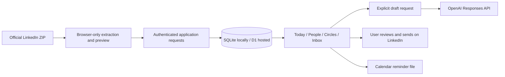

# Architecture

## Two Runtimes, One Application

- `web/`: rendering, keyboard/focus management, forms, separate demo state.
- `shared/`: data normalization, identity matching, ranking, calendar output, import parsing.
- `server/api.js`: authenticated operations, validation, owner scoping, request limits.
- `server/store.js`: relational storage with JSON records, transactional message-state updates.
- `server/node.mjs`: loopback development; protected HTTPS-origin production deployment.
- `server/worker.js`: hosted Sites identity headers, static assets, the same request handler.
- `scripts/build.mjs`: browser bundle plus a self-contained Worker and migration metadata.

A database is durable storage independent of the browser. This matters because losing a browser tab must not mean losing relationship context. SQLite keeps self-hosting simple; D1 removes disk management for the hosted version.

## Trust Boundaries

Owner ID is part of every private record query. Sites supplies validated identity; self-hosting is a single-owner password workspace. Local development binds only loopback and strips hosted identity headers. Mutation requests require the app's origin. Password sessions are signed, expiring, HttpOnly, Secure, and SameSite=Lax.

Only five static assets are served. There is no directory listing or route to local credentials. The optional model key never enters the browser. Demo state cannot write to the real workspace.

Message insertion and conversation-state updates share a transaction. Older replies cannot reopen a conversation answered more recently. Imports match stable identifiers and do not overwrite notes or circles for matching people. Backups merge, not replace.

## All-Or-Nothing Workspace Imports

`shared/import-validation.js` checks the whole backup in both browser preview and server processing. Malformed records, oversized collections, and messages without a resolvable contact reject the import rather than silently dropping history. The server resolves message contact IDs after identity matching and scopes that lookup to the current owner.

Contacts, new circles, historical messages, restored preferences, and the import receipt share one database batch. A transaction means those changes either all commit or all roll back. The local SQLite adapter explicitly rolls back on failure; hosted [D1 batches provide transactional rollback](https://developers.cloudflare.com/d1/worker-api/d1-database/). Restoring historical messages does not change the current reply state for matched contacts. Existing circle records and notification preferences remain unchanged.

Rows are packed into UTF-8 JSON parameters of at most 512 KiB, then inserted through `json_each`. This avoids one database request per contact. Two reads plus at most 45 write statements stay below the [D1 Free per-request query limit](https://developers.cloudflare.com/d1/platform/limits/). Larger prepared imports are rejected before writing. Tests cover a 10,000-contact synthetic import locally and an injected failure after every planned write; they do not constitute a production D1 load test.

The UI clears the old preview before reading another file, announces a persistent error, and ignores late results from a superseded selection or closed dialog.

## Conversation Entry Recovery

`web/reply-buffer.js` keeps unsaved message text and direction in memory, keyed by workspace and contact. Rendering the Conversation panel restores that entry. Each save captures the person, values, and edit revision; only an acknowledgement for unchanged input clears the buffer. A slow response preserves newer typing and its cursor, and finishing one person's save does not redraw another person's form. Per-person pending state blocks duplicate submissions even after the drawer is reopened.

Status is announced politely and linked to the message field. Reload/close requests trigger a browser unload warning while text or a save remains pending. Switching between private and demo workspaces redirects to an unsaved entry instead of discarding it; a confirmed import waits for outstanding message saves. No new browser-persistent cache or server autosave is introduced for these entries.

This does not provide exactly-once message recording after a lost network acknowledgement: the existing message endpoint assigns a new ID on each request. Retry after an ambiguous response may duplicate history. That requires a separate idempotency change and fault-injection test. Tests in this iteration simulate rejection before a write, successful slow saves, and newer edits, not that network ambiguity.

## Known Boundaries

This is not end-to-end encrypted. The hosting operator can access stored data. Protect backups and hosting access. Per-process request limiting is modest protection for an owner-private app, not a distributed anti-abuse system. Browser notifications require an open app; calendar alarms are delegated to the user's calendar. No scheduled LinkedIn sync exists.
